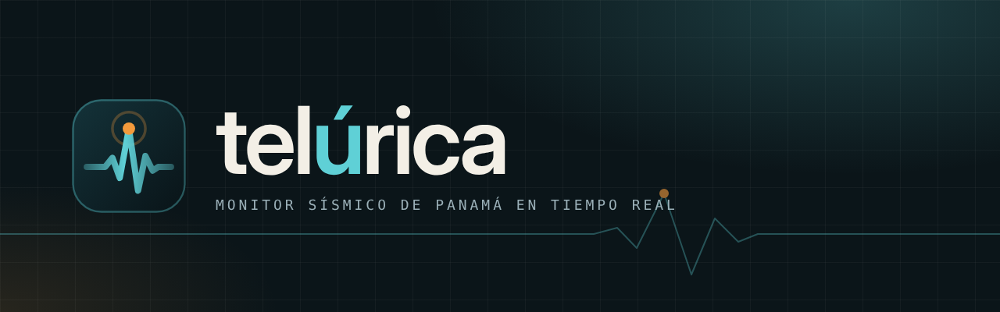

<div align="center">



# Telúrica

**Sismos en Panamá, en tiempo real.**

[Abre Telúrica en producción](https://telurica-panama.vercel.app)
Detecciones en vivo de EMSC y USGS, filtradas al territorio panameño y su zona marítima, con mapa, historial, análisis y alertas en el navegador.


[](https://github.com/pablo2611/telurica/actions/workflows/ci.yml)

</div>

> ⚠️ **No predice terremotos ni reemplaza los avisos oficiales.** Ante una emergencia siga a [SINAPROC](https://www.sinaproc.gob.pa/alertas/) y llame al 911.

## ✨ Qué hace

| Vista | Descripción |
|---|---|
| **Resumen** | Feed en vivo (WebSocket EMSC + USGS), cifras de 30 días, mapa, registro, datos de impacto USGS y titulares |
| **Monitor** | Mapa interactivo (MapLibre) con filtros de magnitud, capas y cronología |
| **Tectónica** | 5 placas, 7 límites y 6 fallas con enlace al mapa y diagrama del subsuelo |
| **Historial** | Archivo hasta 400 días con exportación CSV/GeoJSON |
| **Análisis** | Gráficos de actividad (ECharts) |
| **Alertas** | Reglas por magnitud, zona, provincia, profundidad y fuente; sonido, vibración y notificaciones del navegador |
| **Educación** | Qué hacer antes, durante y después de un sismo |
| **Fuentes** | Estado en vivo de USGS, EMSC y NOAA |

## ⚡ Tiempo real — cómo funciona

```
EMSC WebSocket (push) ─┐
                       ├─► navegador: filtro geográfico ─► "Detección en vivo" + sync inmediata
USGS all_hour (servidor) ─┘                                         │
                                                                 ▼
             servidor (TanStack Start): USGS FDSN + EMSC FDSN ─► dedupe ─► clasificación ─► alertas
```

1. El navegador abre `wss://www.seismicportal.eu/standing_order/websocket` (EMSC) y solicita cada 30 s el feed `all_hour.geojson` de USGS a una server function con caché compartida. El servidor llama al endpoint oficial y filtra su recuadro.
2. Si aparece un sismo dentro de Panamá o a ≤ 150 km de su costa, se muestra al instante como **dato preliminar** y se pide al servidor una sincronización sin caché.
3. El servidor consolida ambas agencias (deduplicación por hora, distancia y magnitud) y las reglas de alerta se evalúan sobre esos datos confirmados.

Todas las APIs son **públicas y sin clave**. Detalles en [`API_SOURCES.md`](API_SOURCES.md) y [`ALERT_SYSTEM.md`](ALERT_SYSTEM.md).

## 🛰️ Mapa satelital 3D

El Monitor usa MapLibre GL (WebGL, fluido incluso en móvil) con:

| Capa | Fuente | Notas |
|---|---|---|
| Satélite + etiquetas | Esri World Imagery / World Boundaries and Places | Atribución obligatoria; revisa los [términos de Esri](https://www.esri.com/en-us/legal/terms/full-master-agreement) si el uso es comercial |
| Mapa oscuro | CARTO dark_all | © OpenStreetMap · © CARTO |
| Relieve 3D real | AWS Terrain Tiles (terrarium) | Datos abiertos, sin clave |
| Fallas y placas | `src/data/tectonics.ts` | Trazas simplificadas (UP, IGC, Kellogg et al.) |

Controles: Satélite/Oscuro, Relieve 3D, Fallas, Columnas (altura por magnitud) y Calor. Los sismos de las últimas 24 h laten en el mapa.

**Demo sin instalar nada:** abre `demo/telurica-mapa-satelital.html` en tu navegador (necesita internet): mapa satelital, relieve 3D y datos en vivo de USGS y EMSC.

## 🚀 Arranque local

Requisitos: **Node.js 22** y npm. La versión está fijada en `.nvmrc`.

```bash
npm ci
npm run dev        # http://localhost:3000
npm test           # pruebas (Vitest)
npm run typecheck  # TypeScript
npm run lint       # ESLint
npm run build      # build de producción (.output/)
npm start          # sirve el build con Node
```

## ☁️ Despliegue

El build usa [Nitro](https://nitro.build), que detecta el proveedor automáticamente:

- **Vercel:** importa el repo `pablo2611/telurica`, selecciona TanStack Start, Node 22 y `npm run build`. Deja la salida en la configuración automática de Nitro y no añadas variables de entorno. Desde CLI, ejecuta `npx vercel link` y `npx vercel --prod`.
- **Node / VPS / Docker:** `npm run build && node .output/server/index.mjs`.
- **Cloudflare:** `NITRO_PRESET=cloudflare_module npm run build`.

## 🧱 Stack

React 19 · TypeScript · Vite · TanStack Start / Router / Query · Tailwind CSS v4 · Motion · MapLibre GL · Apache ECharts · Zod · Radix UI · Lucide.

Componentes animados en [`src/components/reactbits/`](src/components/reactbits) inspirados en [React Bits](https://www.reactbits.dev) (BlurText, CountUp, SpotlightCard, AnimatedList, StarBorder, ShinyText, GradientText, Magnet, DecryptedText, ClickSpark y un fondo de sismograma en canvas), reimplementados sin dependencias extra.

## 📁 Estructura

```
src/
├── routes/                 # Páginas (rutas por archivo)
├── features/seismic/       # Adaptadores, dedupe, geo, alertas, tiempo real
├── components/
│   ├── reactbits/          # Primitivas animadas
│   ├── seismic/            # Piezas de dominio (magnitud, feed en vivo…)
│   ├── map/ charts/ site/  # Mapa, gráficos, layout
│   └── ui/                 # shadcn/ui + Magic UI + Aceternity
├── data/panama-geo.json    # Límites (geoBoundaries, CC BY 4.0)
└── test/                   # Vitest
```

Más documentación: `DATA_ARCHITECTURE.md`, `GEOGRAPHIC_FILTERING.md`, `DESIGN_SYSTEM.md`, `COMPONENTS_SOURCES.md`, `SECURITY.md`, `TESTING.md`, `BROWSER_COMPATIBILITY.md`.

## 🎨 Marca

| Recurso | Archivo |
|---|---|
| Isotipo (SVG) | `public/favicon.svg` · `docs/logo.svg` |
| Logotipo horizontal | `docs/logo-full.png` |
| Imagen social (1200×630) | `public/og-image.png` |
| Iconos app | `public/icon-192.png` · `public/logo-512.png` · `public/apple-touch-icon.png` |
| Componente React | `src/components/brand/Logo.tsx` |

Colores: fondo `#0b1519`, acento `#5fd0d6`, epicentro `#f39a3c`. Tipografía de marca: Inter Tight 600.

## 📜 Licencia

[MIT](LICENSE). Datos: USGS (dominio público), EMSC, NOAA. Límites: geoBoundaries (CC BY 4.0). Mapa base: © OpenStreetMap contributors / OpenFreeMap.

## Savia · asistente de datos

La sección `/savia` ofrece consultas sobre el catálogo de Panamá con NVIDIA Nemotron 3.5 Lightning. Presenta cifras calculadas en servidor, distribución terrestre por provincia y un mapa de densidad de epicentros. Cada consulta es independiente y admite 24 horas, 7 o 30 días. El texto se muestra escapado por React.

### Activación

Configura exclusivamente en el proyecto Telúrica del equipo autorizado de Vercel estas variables de servidor.

| Variable | Uso |
| --- | --- |
| `NVIDIA_API_KEY` | Clave privada NVIDIA |
| `UPSTASH_REDIS_REST_URL` o `KV_REST_API_URL` | URL HTTPS del almacén persistente |
| `UPSTASH_REDIS_REST_TOKEN` o `KV_REST_API_TOKEN` | Token privado Redis REST |
| `SAVIA_HASH_SECRET` | Secreto aleatorio de al menos 32 caracteres para anonimizar IP |
| `SAVIA_ENABLED` | `true` para activar después de configurar las protecciones |

Savia permanece deshabilitada si falta una variable. El estado público solo comunica disponibilidad de IA. Si NVIDIA o su cuota no permiten una respuesta, el navegador solicita el catálogo mediante la caché compartida existente y muestra un resumen determinista, identificado como automático, junto a su gráfica y mapa. Este resumen no interpreta libremente la pregunta ni predice riesgos. No expone nombres de secretos ni sus valores. El servidor rechaza orígenes ajenos y cuerpos mayores de 4 KiB. La identidad de red procede del ingreso Vercel. Para desplegar en otro dominio se debe añadir explícitamente a la lista de orígenes permitidos.

### Cuotas y consumo

Las reservas Lua son atómicas entre instancias y despliegues del mismo almacén. Límites iniciales de 3 consultas/minuto y 10/día por IP anonimizada, 100/día y 1500/mes globales, 2 consultas concurrentes. Los días y meses de cuota usan UTC. Los intentos fallidos también consumen reserva. Un lease expirado se limpia automáticamente. Una incidencia de Redis cierra el chat antes de llamar a NVIDIA.

Cada consulta admite 600 caracteres, un período acotado y una llamada NVIDIA con máximo 900 tokens de salida, razonamiento desactivado y timeout de 15 segundos. Las fuentes reutilizan la caché existente de Telúrica. Las respuestas iguales se reutilizan durante hasta 60 segundos, con fecha original visible. La bienvenida y las sugerencias son locales. La caché Redis de respuesta contiene la pregunta solo en forma HMAC y la respuesta durante un minuto. No se guarda historial de conversaciones en servidor. NVIDIA recibe la pregunta y un resumen del catálogo. No introducir datos personales.

El mapa muestra hasta 300 eventos recientes. La estadística se calcula sobre todo el catálogo del período. Densidad observada no equivale a amenaza ni a aptitud para construir. Las decisiones sobre terrenos requieren microzonificación, estudios geotécnicos y profesionales. Los modelos pueden producir errores y los límites temáticos no garantizan eliminar toda inyección de prompts.

Antes de habilitar tráfico público, configurar límites WAF sobre `/api/chat` en Vercel y verificar la cuota gratuita del almacén. Las cuotas de aplicación acotan llamadas de IA, pero el tráfico bloqueado, las funciones y el almacén pueden consumir recursos propios. La cuota gratuita NVIDIA es independiente de Vercel y su disponibilidad debe verificarse en la cuenta. No activar facturación automática ni cambiar de plan para habilitar este módulo.

### Verificación

CI compila, regenera las rutas, ejecuta pruebas, lint y typecheck con Node 22. Incluye pruebas de origen, tamaño real de cuerpo, cierre sin configuración, rechazo de temas ajenos, fallo de almacén y concurrencia del script Lua contra Redis efímero. Desactivar con `SAVIA_ENABLED=false` y volver a desplegar. Una clave compartida accidentalmente debe revocarse y reemplazarse.
